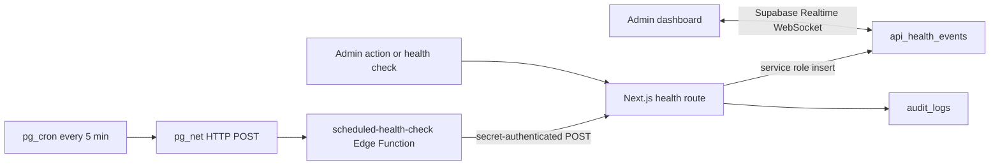

# External APIs Runbook

## Operations Catalog

The rates below are the service wrapper's per-provider limits and per-operation cache TTLs (`src/lib/external-apis.ts`). In-memory cache and health counters are process-local; Redis is used when `REDIS_URL` is configured.

| Site | Operation | Cache TTL | Rate limit | Status |
|---|---|---:|---:|---|
| globalpetrolprices | fuel_prices | 5 min | 30/min | Verified |
| globalpetrolprices | gasoline_price_history | 5 min | 30/min | Verified |
| globalpetrolprices | diesel_price_history | 5 min | 30/min | Verified |
| globalpetrolprices | kerosene_price_history | 5 min | 30/min | Verified |
| globalpetrolprices | diesel_price_dsm | 5 min | 30/min | Verified |
| globalpetrolprices | gasoline_price_dsm_summary | 5 min | 30/min | Verified |
| globalpetrolprices | kenya_fuel_prices | 5 min | 30/min | Verified |
| tpa | vessel_schedule | 5 min | 30/min | Verified |
| exchangerate | rates | 1 hr | 30/min | Verified |
| nager | holidays_tz | 24 hr | 30/min | Verified |
| tra | declaration_status | 1 min | 30/min | Unavailable: portal access required |
| border | wait_times | 1 min | 30/min | Unavailable: no verified live feed |
| sendy | quote_delivery | 5 min | 20/min | Unavailable: no verified working endpoint |

Operations without an explicit cache entry use the wrapper default of 60 seconds.

## API Routes

All routes use the app's authenticated API middleware and its configured role allowlist. Calls can also be rate-limited by the app gateway.

| Route | Parameters | External cache |
|---|---|---:|
| `GET /api/external/fuel/prices` | `region`, `history`, `fuel`, `summary`, `compare`, `format=json\|csv` | 1-5 min by operation |
| `GET /api/external/fuel/ewura-caps` | none; latest official monthly PDF | 6 hr process cache |
| `GET /api/external/tpa/vessel-schedule` | none; current public snapshot | 5 min |
| `GET /api/external/fx/rates` | `base` (default `TZS`) | 1 hr |
| `GET /api/external/holidays/tanzania` | `year` (defaults to current year) | 24 hr |
| `GET /api/external/health` | none | no-store health snapshot |
| `POST /api/external/health` | `{"action":"invalidate-cache"}` or `{"action":"test-endpoints"}` | action endpoint |
| `GET /api/external/tra/customs-status` | `declaration_id` | 1 min |
| `GET /api/external/border/wait-times` | `crossing` | 1 min |
| `POST /api/external/sendy/quote` | `origin`, `destination`, `weight` | 5 min |
| `GET /api/map/locations` | bearer session | no-store; manager roles only |

Fuel examples:

```text
/api/external/fuel/prices?region=tanzania
/api/external/fuel/prices?region=tanzania&history=true&fuel=kerosene
/api/external/fuel/prices?region=kenya&fuel=all
/api/external/fuel/prices?region=dsm&summary=true&fuel=gasoline
/api/external/fuel/prices?compare=true
/api/external/fuel/prices?compare=true&format=csv
```

`compare=true` returns available national Tanzania and Kenya prices side by side. It does not convert currencies. The TPA response is a current snapshot containing berth/sailing and waiting-queue tables; it does not support a date filter. Fuel feeds publish national prices, not city-specific prices.

`format=csv` exports the selected feed; `compare=true&format=csv` exports Tanzania/Kenya fuel comparisons. CSV fields are quoted and spreadsheet-formula-leading values are escaped. [EWURA publishes official retail caps](https://www.ewura.go.tz/pages/petroleum-product-pricing) for named towns in monthly PDF notices, not a public JSON API. The map fetches the latest PDF from EWURA's official pricing page, parses the six fleet hubs, and marks diesel caps green/amber/red relative to their mean. These are price ceilings rather than station quotes; the GlobalPetrolPrices feed remains the national benchmark. If PDF retrieval or parsing fails, the map shows the national benchmark with city-price-unavailable markers. The source publishes current town caps monthly; historic trends still use the available GlobalPetrolPrices national series.

On the fleet map, press **F** for fuel, **P** for port, **B** for borders, **M** for market rates, and **Escape** to close a panel. The selected panel is stored in local storage on that browser.

## Admin Health Dashboard

Open `/admin/api-health` as a CEO or ADMIN. The dashboard subscribes to Supabase Realtime over WebSocket and switches to 15-second HTTP polling if the channel fails; it does not poll while Realtime is connected. It exposes process-local call/latency state, cache hit/miss counters, heap/RSS, Redis status, cache invalidation, and checks for configured live providers (TPA, Tanzania fuel, FX, holidays). Alerts are raised at latency above 2 seconds, error rate above 5%, or cache hit rate below 70%. Admin cache invalidations, endpoint-check actions, and scheduled check results are written to `audit_logs` when the database is available. Realtime event reads are restricted by RLS to CEO and ADMIN.

### Realtime and scheduled checks



`src/lib/event-stream.ts` remains a Redis Streams bus for application events; it does not serve the admin WebSocket. To enable the scheduled job in a Supabase project:

1. Set `APP_BASE_URL` and a random `EXTERNAL_HEALTH_CHECK_SECRET` of at least 32 characters as Edge Function secrets; set the same secret in the Next.js server environment. This function has JWT verification disabled in `supabase/config.toml` and uses constant-time comparison of the dedicated header secret.
2. Deploy `scheduled-health-check`, then apply migrations 139 and 140.
3. In Supabase Vault, create `supabase_functions_url` (full `/functions/v1/scheduled-health-check` URL) and `external_health_check_secret`. Never store an anon or service-role key in the cron job.
4. Run `select public.schedule_external_api_health_check();` in the Supabase SQL editor. This installs the five-minute `pg_cron` job through `pg_net`. Confirm it exists in `cron.job` and `net._http_response`, then verify an audit row and an `api_health_events` insert.

This repository includes the function and migrations but has not deployed them to a remote Supabase project. See [Supabase Realtime database subscriptions](https://supabase.com/docs/guides/realtime/subscribing-to-database-changes), [pg_cron](https://supabase.com/docs/guides/database/extensions/pg_cron), [pg_net HTTP requests](https://supabase.com/docs/guides/database/extensions/pg_net), and [Edge Function security](https://supabase.com/docs/guides/functions/auth). The Edge Function checks the shared secret, forwards only to a fixed internal health-check route, and the route bypasses the application cache to probe a fixed allowlist of four configured operations. It records HTTP latency and alerts when an endpoint fails or exceeds two seconds; cache-hit thresholds are evaluated by the dashboard from its own runtime counters.

### PDF export

Use **Export PDF** on `/admin/api-health`. It downloads `api-health-report-YYYY-MM-DD.pdf` (East Africa date) with provider status, latency/error-rate rows, cache/runtime summary, and up to 12 recent external API admin audit actions. jsPDF is loaded on click so it does not add its code to the initial admin bundle.

The cache invalidation action clears keys observed by the current process and its local memory cache. It does not discover unrelated Redis keys. In a multi-instance deployment, check each instance if cache entries are held in process memory.

## Unavailable Sources

- **TRA customs status:** The public declarations API has not been verified; customs status requires authorized TRA portal access. Use the [TRA portal](https://identity.tra.go.tz/Account/Login) and do not treat the API route's unavailable response as a declaration result.
- **Border wait times:** No verified public live feed is configured. Contact the border post or check through authorized TRA channels before dispatch.
- **Sendy:** No working public endpoint has been verified for this deployment. Do not use the quote route as a confirmed rate until an authorized working service endpoint is configured.

## Troubleshooting

- `OPERATION_UNAVAILABLE` / unavailable response: the operation is missing from the API Anything site specs or is not available in the configured home.
- `429 RATE_LIMITED`: wait for the indicated retry window; avoid polling repeatedly.
- `502` / `EXTERNAL_API_FAILED`: inspect the response's error code and provider health; test the relevant operation with API Anything CLI.
- `503` / auth or blocked: source authentication or bot protection needs authorized resolution.
- Health page shows “Not called yet”: health counters are process-local and have not observed a call in this process.
- FX `base` must be a three-letter code; holiday `year` must be from 2000 to 2100.

## Local Tests

- `npm run test:unit` runs database-independent unit tests.
- `npm run test:e2e` starts a local Next.js dev server and runs the mocked Playwright UI flows for map controls, health actions, and fuel query variants.
- `npm test` runs integration tests and requires Docker, `npx supabase start`, a fresh `npx supabase db reset`, and a gitignored `.env.test.local` copied from `.env.test.example` with local-only keys. Do not put production keys in that file.
