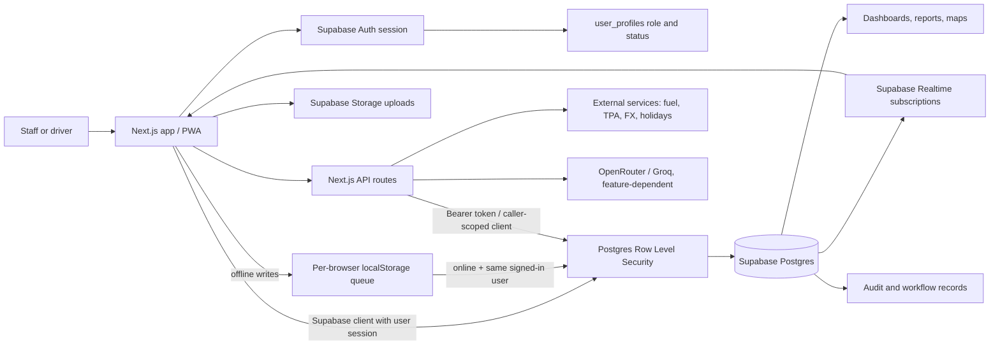

# Calvary Connect: Whole-System Data Flow

This document describes the current application paths from user action to stored data and back to dashboards. It is based on the Next.js and Supabase implementation in this repository; planned integrations are labeled separately from live paths.

## System map



## Main operational lifecycle

```mermaid
sequenceDiagram
  actor Sales as Sales / customer-facing staff
  actor Ops as Operations
  actor Driver
  actor Finance as Finance
  participant App as Next.js UI
  participant DB as Supabase Postgres + RLS
  participant Storage as Supabase Storage
  participant RT as Supabase Realtime

  Sales->>App: Create customer, quote, booking
  App->>DB: Write using signed-in session; RLS checks role and ownership
  Ops->>App: Assign vehicle and driver; create trip
  App->>DB: Save trip and audit event
  DB-->>RT: Publish subscribed table changes
  RT-->>App: Refresh relevant screens
  Driver->>App: Update trip, log fuel/expense/fine, submit POD
  App->>Storage: Upload receipt or POD evidence when online
  App->>DB: Save record or queue supported write while offline
  Ops->>DB: Verify POD
  DB-->>Finance: POD workflow creates/links invoice for review/send
  Finance->>DB: Send invoice / record payment through finance workflow
  DB-->>App: Updated records feed dashboards and reports
```

The trip and POD screens are separate stages. Creating a trip does not itself prove delivery or authorize an invoice; invoice generation belongs to the verified POD workflow. Payment posting and journal behavior depends on the finance workflow/RPC used by that route.

## Connectivity and trust boundaries

1. **Sign-in:** Supabase Auth establishes the browser session. `SupabaseProvider` loads the matching `user_profiles` row and role; client route guards shape navigation and access.
2. **Authorization:** Database RLS is the data boundary. Client-side route visibility is not a substitute for RLS. Server API routes that act on behalf of a user should validate the bearer token and use a caller-scoped Supabase client for business-data access. Service-role access must stay server-only and narrowly scoped.
3. **Writes:** Most screens call Supabase directly or through data hooks/services. Uploads use Supabase Storage. Audit logging is present on selected service paths; it is not automatically guaranteed for every direct table write.
4. **Offline writes:** The browser stores queued mutations in `localStorage`, associated with the user ID. When online, mutations replay sequentially under the currently signed-in user's session, so RLS is checked again. A different user's queued items remain pending. Attachments are not uploaded offline; driver expense receipts are attached after the record syncs.
5. **Live refresh:** Screens with Supabase Realtime subscriptions receive changes for their subscribed tables. Other screens refresh on mount, explicit refresh, or their own polling. There is no single app-wide event bus for every database write.
6. **External data:** External API routes provide the fuel benchmark, TPA vessel schedule, FX rates, and Tanzania holidays. TRA customs, public border wait feeds, and Sendy remain unavailable per `EXTERNAL_APIS_RUNBOOK.md`; the UI should show unavailable/manual-check status, not inferred live data.
7. **AI:** AI is a feature-specific server route. The company analyst reads only the tables it explicitly loads, reports source connectivity, and calls OpenRouter/Groq. AI output is not a database mutation and should not be treated as authoritative until a user confirms the underlying business record.

## Offline scope and recovery

Supported offline behavior is a local write queue for selected create/update/delete calls and explicit driver expense/fine capture flows. Reads are not a complete offline replica: a screen that has not already loaded or locally retained data may be empty while offline. GPS, realtime, authentication, external APIs, AI responses, and file uploads require connectivity. Queue state is device/browser-local and can be lost if site storage is cleared; users should wait for the sync-complete indication before switching devices or clearing browser data.

Queued inserts use a stable UUID so retries after an interrupted response do not create duplicate rows. Updates and deletes carry their target ID. Sync replays through the authenticated Supabase client and reports remaining failures for retry; RLS/schema errors remain queued and need correction before they can sync.

## Operational troubleshooting path

| Symptom | Check in this order |
| --- | --- |
| Sign-in succeeds but a module is empty | Confirm active `user_profiles` row and role; inspect the query error and relevant RLS policy. |
| Write is rejected | Check role, ownership fields, schema/constraints, then RLS; client visibility does not grant database access. |
| Offline item stays pending | Confirm the same user is signed in, connection is restored, then inspect the stored row shape and Supabase error/RLS policy. |
| POD exists but invoice does not | Check POD verification status, trip revenue fields, existing invoice link, and invoice creation/send RPC errors. |
| Map marker or trip progress is stale | Check the last GPS/telemetry timestamp, driver device permissions/network, ingestion endpoint, and subscription or refresh behavior. |
| External panel says unavailable | Check route health/cache and provider status; confirm the source is actually public and configured. Do not substitute sample values as live data. |
| AI analysis is incomplete | Check its per-table source status, user RLS visibility, and provider response metadata. Treat unavailable tables as missing evidence. |

## Maintainer rule

For each new workflow, define the source record, owner/role, status transitions, validation/RLS, offline behavior, audit trail, downstream consumers, and recovery message. Link records with database foreign keys where possible; avoid copying mutable values across modules without recording their source and timestamp.
